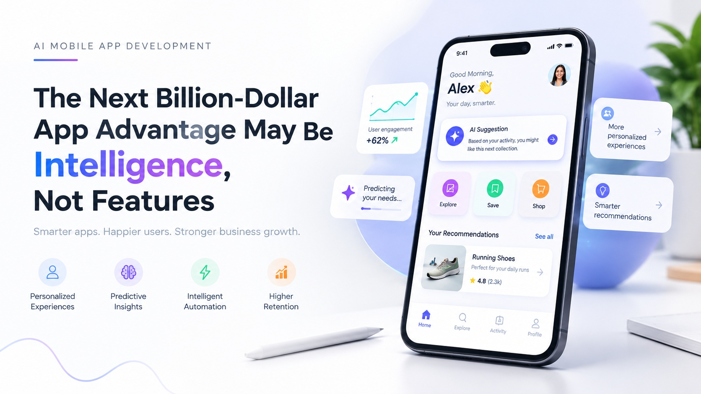
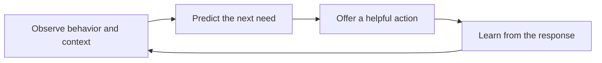

# The Next Billion-Dollar App Advantage May Be Intelligence, Not Features

*Smarter apps. Happier users. Stronger business growth.*

Feature lists win demonstrations. Intelligence wins retention. Most mobile products compete by adding screens, options, and settings, and most rivals can copy those within a release cycle. What is far harder to copy is an app that learns from how each person uses it and acts on that understanding before the user asks.

That is the idea behind [Predictive Intelligence for Mobile Apps](https://zignuts.com/ai-services/custom-ai-development/ai-mobile-app-development-services?utm_source=seo_web2.0&utm_medium=backlink&utm_campaign=seo_referral&utm_id=10): using behavior, context, and history to anticipate what the user needs next, whether that is a recommendation, a reminder, a shortcut, or a warning. It turns a product that waits for instructions into one that helps.

This brief is for product and technology leaders deciding where to invest. It explains how intelligence differs from features, what the four capabilities in the banner mean in practice, and how to build them responsibly.

---

> **At a glance**
>
> - Features are easy to copy. Learning from your own users is not.
> - Intelligence works as a loop: observe, predict, act, learn.
> - Trust is part of the product. Consent, explanation, and control are design requirements, not afterthoughts.

---

## Features Compete. Intelligence Compounds.

| Dimension | Feature-led app | Intelligence-led app |
|---|---|---|
| **Copyability** | A competitor can match it in a release | Depends on your data and learning, which are harder to match |
| **Experience** | The same for every user | Adapts to each person's behavior and context |
| **Value over time** | Flat after launch | Improves as the app learns |
| **Role of data** | Reporting after the fact | Input to what the app does next |
| **Retention driver** | New releases | Relevance that grows with use |

## The Intelligence Loop

Each pass through the loop makes the next prediction better, provided the app records whether its suggestion was accepted, ignored, or rejected.

## Four Capabilities, and How to Test Each

| Capability | What it means | A question to test it |
|---|---|---|
| **Personalized experiences** | Content and layout shaped by the individual | Would two different users see a meaningfully different home screen? |
| **Predictive insights** | Anticipating needs from patterns in behavior | Does the app act before the user has to search? |
| **Intelligent automation** | Handling routine steps without being asked | Which taps could the app remove entirely? |
| **Higher retention** | Relevance that gives users a reason to return | Do users who accept suggestions stay longer than those who do not? |

## A Maturity Ladder

1. **Static.** Everyone sees the same app.
2. **Segmented.** Groups see different content based on simple rules.
3. **Personalized.** Each user sees content based on their own history.
4. **Predictive.** The app anticipates the next need and prepares for it.

Most products sit at level two. The advantage appears at levels three and four, where the product starts to learn.

## Responsible by Design

Predictions rely on personal data, so trust must be built in from the start.

- **Collect only what you use.** Every data point needs a stated purpose.
- **Explain suggestions.** A short "why you are seeing this" builds confidence.
- **Give users control.** Let them correct, dismiss, or switch off personalization.
- **Fail gracefully.** The app must remain useful when a prediction is wrong or unavailable.
- **Watch for harm as well as lift.** Review whether suggestions disadvantage any group of users.

## Measuring What Matters

Choose measures that show whether intelligence changes behavior, not only whether it exists.

- Retention by cohort, compared with a control group
- Task completion and time to first value
- Suggestion acceptance and dismissal rates
- Opt-out rate for personalization
- Support contacts related to suggestions

A holdout group that does not receive the intelligent feature is the most reliable way to separate its effect from seasonal change and marketing activity.

## Where to Start

1. Pick one moment in the user journey where a better prediction would help.
2. Define exactly what the app will predict and what it will do with the result.
3. Confirm the data and consent you have for it.
4. Ship one small intelligent surface, not a redesign.
5. Test it against a control group.
6. Expand only when the evidence holds.

## Questions for Your Next Roadmap Review

- Which of our features could a competitor copy in one release?
- What does our app learn from its users that no one else can learn?
- Where does a user repeat the same steps every week?
- What would we need to explain, and to whom, if a suggestion were wrong?
- How will we know the feature worked, and not the campaign beside it?

---

**Ready to build apps that learn?** Visit [zignuts.com](https://zignuts.com/?utm_source=seo_web2.0&utm_medium=backlink&utm_campaign=seo_referral&utm_id=10) to speak with the team.
